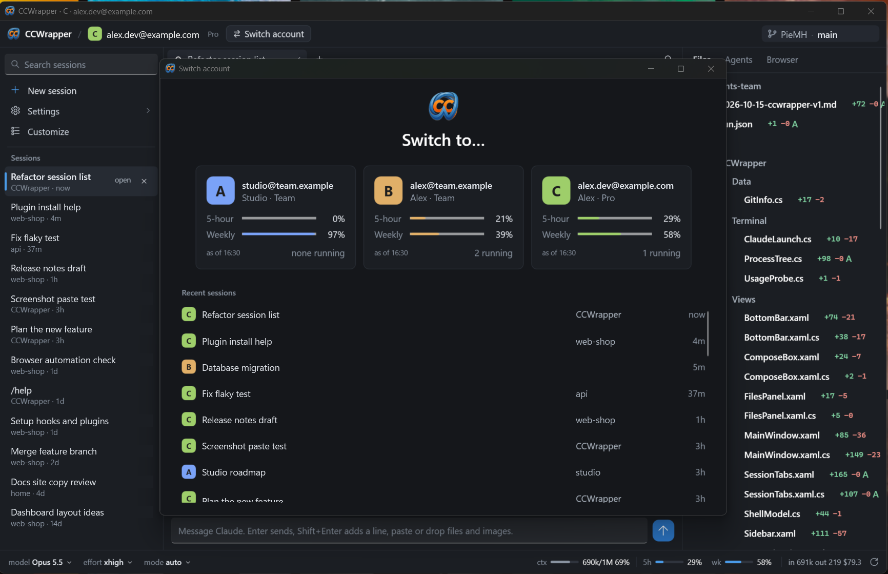

# CCWrapper

**A lightweight native Windows GUI around the real Claude Code terminal. Sessions as tabs, one account per window, as many windows as you like.**


Claude Code in a bare PowerShell window works, but it's clumsy. There's no search, you can't paste screenshots or files with Ctrl+V, you can't see your other sessions, and context, usage, file changes and subagents are hard to keep an eye on. If you also juggle **several Claude Code accounts** (work and personal, for example), it gets worse.

CCWrapper keeps Claude Code exactly as it is and builds a Claude Desktop-style app around it. The chat, permission prompts, slash commands and menus all stay Claude Code's own TUI, so every Claude Code update works the day it ships.



*The main window with the account switcher open. Names, emails and session titles in the screenshot are made up.*

## What it is

CCWrapper is for people who live in Claude Code on Windows, often with more than one account (a work Team plan and a personal Pro, for example). Each window is one account, started the way Claude Code itself would be (`CLAUDE_CONFIG_DIR`), with that account's own settings, plugins and hooks. Inside the window:

- **Every session is a tab** running in parallel, with a live status icon, so you see at a glance which one is working, which one waits for you and which one is done.
- **The sidebar knows every session of the account**, including ones you started in plain PowerShell. Click one to bring it here; if it is open in another terminal, CCWrapper says where and can take it over for you.
- **Usage is live:** the 5-hour and weekly plan limits come from Claude Code's own `/usage`, for every account, on the start screen and in the bottom bar.
- **The terminal gets the comforts it lacks:** Ctrl+V for screenshots and files, Shift+Enter for new lines, search, a compose box, changed files with diffs, subagents, a built-in browser that Claude can use too, and the git state of the folder you are in.

It stays light: a native WPF app (no Electron), Windows' own icon font, a dark slate theme with the logo's blue, and no heavy animation.

## Features

**Start screen**
- A "Who's working?" picker shows one card per Claude Code account, with its email, plan, and 5-hour and weekly usage bars, checked live when the screen opens.
- Below the cards is a list of recent sessions from every account, each with its account badge. Click one to resume it.

**One account per window**
- Each window runs one account with that account's own settings. To run accounts side by side, open more windows.
- **Switch** in the top bar restarts the window as another account. Its sessions stay resumable.
- The top bar also shows the repo's git state: the GitHub account it pushes as, the branch, and the commits to push (↑) and pull (↓) as of the last fetch.
- `CCWrapper.exe --account b` skips the picker, so you can make one shortcut per account.
- The taskbar badge shows each window's account letter and color.

**Sidebar**
- **Session search:** typing filters by title and project. Enter searches the full text of every transcript of the account.
- **Session list:** every session of the account, including ones started outside the app, newest first, with a status label (*working*, *needs you*, *open*) and a blue marker on the one you are looking at.
  - Titles follow Claude Code: the name given at start or with `/rename`, else its own title for the chat. A session's `/color` tints its title.
  - Click a session to open it: if it already has a tab, that tab comes forward; otherwise it is resumed in its original folder in a new tab. Nothing open is closed.
  - Right-click a session, here or on its tab, for **Name…** (sends `/rename`), **Color** (sends `/color`) and **Delete…**. Name and Color need the session open in this window. Delete asks first, then removes the session's transcript and its folder for good, so it cannot be resumed; it is refused while any claude process has the session open.
  - A session open in another terminal gets a read-only tab that says where it is open, e.g. "PowerShell (pid 51708, since 15:07)". **Resume here** offers to close it there (the conversation is saved) and turns the tab into a live one; **Continue here as a copy** forks it instead.
- **About:** version, the update switch and links to the policies (privacy, terms, code signing, security, third-party notices). When an update is downloaded, a chip "Update X ready" in the bottom bar restarts into it.
- **Settings:** a window for the account's `settings.json` and the project folder's shared and local ones, without opening the files.
  - **General:** model, effort (also per model), output style, language, theme, time format, update channel, commit trailer and claude.ai connectors.
  - **Permissions:** the default mode and the allow, ask and deny rules. **Hooks** and **Environment** variables can be added, edited and removed; values that look like keys or tokens stay hidden until clicked.
  - **Interface:** the switches of `/config`: auto-compact, rewind checkpoints, verbose output, turn duration, tips, reduced motion, terminal progress bar, `.gitignore` in the file picker, editor mode and notifications.
  - Each setting says where its value comes from: set in this file, taken from a broader one, or overridden by a more specific one (*Project overrides this*).
  - **CLAUDE.md:** edit the user, project and local `CLAUDE.md` files. **JSON** shows a whole file for anything else.
  - Changes wait for **Save**, which writes only the files you changed and keeps every key the window doesn't show. Open sessions pick settings up as soon as they are saved.
  - **CCWrapper:** the app's own settings, saved in `%LOCALAPPDATA%\CCWrapper\app.json` (not a Claude Code file): the compact hint on or off, its threshold and its prompt, and whether Claude may use the Browser panel.
- **Plugins & connectors:** a window of its own for everything `/plugin` and `/mcp` do, without touching your open sessions.
  - **Plugins:** turn installed plugins on and off; see each one's skills, MCP servers, context cost and notes; update, configure or uninstall it. Plugins synced from your claude.ai account are listed too.
  - **Discover and Marketplaces:** search the marketplaces' catalogs and install to the user, project or local scope; add, update and remove marketplaces.
  - **MCP servers and connectors:** every server with its health (connected, needs sign-in, failed), your own and those of plugins; add or remove your own, and sign in to servers and claude.ai connectors. A switch on each one turns it off for one project folder only, as `/mcp disable` does.
  - Every change runs Claude Code's own `claude plugin` or `claude mcp` command in the background, shown in the window's status strip. New sessions get the change; **Reload idle sessions** sends `/reload-plugins` to the open ones that are idle.
- **New session:** pick a folder, plus optionally a model, effort, permission mode and name. Unchanged fields keep the account's defaults.

**Tabs**
- Every open session is a tab above the terminal, running in parallel: its status (● working, ◎ waiting for you, gently pulsing, ○ idle), its name and a × to close it (asks first if Claude is busy; it stays resumable).
- The blue underline marks the tab you are looking at. Drag tabs to reorder them; **+** starts a new session in a new tab.
- Many tabs shrink to a minimum width, then the bar scrolls sideways with the mouse wheel.

**The terminal, improved**

| Key | What it does |
|---|---|
| Shift+Enter | New line instead of submit |
| Ctrl+V | Screenshot → `[Image #1]` · files, folders and videos copied in Explorer → their paths · text → normal paste |
| Drag & drop | Inserts the dropped files' paths |
| Ctrl+C | Copies when text is selected, otherwise interrupts (Ctrl+Shift+C always copies) |
| Right-click | Copies the selection, or pastes when nothing is selected |
| Ctrl+F | Find in the chat (also the search button at the right of the tab bar), with highlights and a match count. "Search full transcript" covers the whole session. |
| Links | `localhost` links open in the built-in browser, all others in your default browser |

**Compose box** (optional, under the terminal)
- A real multi-line editor with a round send button: Enter sends, Shift+Enter adds a line, and Up recalls earlier prompts.
- When Claude Code suggests your next prompt, the empty box shows it greyed too, as the terminal does: Tab takes it to edit, Enter sends it, typing replaces it.
- Pasted screenshots become image files.
- The **+** button adds files or folders (as a drop would) and opens the slash commands. Typing `/` (or a `/` word after a space or line break) lists Claude Code's commands, your custom commands and skills, and those of your enabled plugins and claude.ai synced plugins (not MCP prompts), narrowing as you type: Up/Down choose, Enter runs it, Tab completes it without sending (after a space or line break, Enter only completes). Text that starts with a known command shows in blue. A long or multi-line command goes in as several short pastes, so Claude Code runs it instead of folding it into `[Pasted text]`.
- Each session keeps its own draft: switching tabs leaves it as it is, and drafts are saved when the app exits (or restarts to update) and come back when the session is reopened.
- It never types into a permission prompt or a dialog. Those you always answer in the terminal.

Confirmations, warnings and errors use the app's dark theme too.

**Right panel**
- **Files:** a tree of every file Claude changed this session, with `+/−` lines in green and red, or the size change for binaries. Click a file to see all of it with the changes highlighted.
- **Agents:** this session's subagents, running or finished, with model, effort, context and tokens. Click one to see its live transcript.
- **Browser:** a built-in WebView2 browser for your dev server, with tabs (the **+** button opens one, up to 20; tabs are not restored after a restart). A pop-up a click opens appears in a new tab; pop-ups a page opens on its own are dropped (a page can still open one in the few seconds after a click, Claude's clicks included, as in any browser), and a page's `window.close()` closes only pop-up tabs. Claude browses in it too: every session can navigate, read the page, click, type, take screenshots, run scripts, use DevTools, and list, open, switch and close tabs there, and is told to prefer it over another browser. Ask for Chrome by name and it uses Chrome. Scripts and DevTools act with the page's own logins in that profile; DevTools refuses cookie access, downloads, local files, all simulated input (keyboard, mouse, touch and drag, so it cannot paste your clipboard), the page history and scripts that persist across pages. Claude opens only http, https, blob, about:blank and data addresses, never local files (a pop-up to any other address is dropped), and its tools refuse to work on a page that is not a web address (for example a `file:` page you opened yourself). Its tools act on the tab in front. To turn this off, clear **Let Claude use the Browser panel** in Settings → CCWrapper.

**Bottom bar**
- Model, effort and permission-mode switches that drive Claude Code's own `/model`, `/effort` and Shift+Tab.
- Meters with small bars for the context window and the 5-hour and weekly plan usage (amber from 80%), plus session tokens and cost. Usage shows even with no session open, is checked when the window opens and every 30 minutes, and the ↻ button checks it now. Hover the usage meters for when the 5-hour and weekly windows reset; click them for a popup with both windows' bars and resets, and the tokens (in, out, cache) by model and by hour of day, counted from the account's transcripts.
- **Compact hint:** once the context passes a threshold (50% by default; set it in Settings), a *Compact* button appears left of the context meter. It puts `/compact` and your keep/drop prompt in the message box and focuses it, but never sends it, and leaves text you already typed alone.

## Requirements

- **Windows 10 (1809 or later) or Windows 11.** Developed and tested on Windows 11.
- **No .NET needed to run it:** the installer's build carries its own runtime. Building from source needs the [.NET 10 SDK](https://dotnet.microsoft.com/download/dotnet/10.0).
- **WebView2 Runtime.** Already part of Windows 11; the installer adds it if it is missing.
- **Claude Code, native install**, so that `claude.exe` is on your `PATH`:
  ```powershell
  irm https://claude.ai/install.ps1 | iex
  ```
  The npm package (`claude.cmd`) isn't supported. Launcher shims (Scoop, Chocolatey) should work but are untested.

## Install

Download **`PieMH.CCWrapper-win-Setup.exe`** from the [Releases page](https://github.com/PieMH/CCWrapper/releases/latest) and run it.

- It installs for your user only (`%LOCALAPPDATA%\PieMH.CCWrapper`), with **no admin rights**, adds a Start menu shortcut and starts CCWrapper. It installs the WebView2 Runtime too if Windows lacks it.
- Updates come with it: an installed copy checks GitHub for a new version, but only after you said yes on first start, and installs it when you quit or when you click the "Update ready" chip in the bottom bar. You can turn the check off in **About** (the sidebar).
- **Code signing:** free code signing provided by [SignPath.io](https://signpath.io), certificate by [SignPath Foundation](https://signpath.org). The project has applied; until SignPath approves it, releases are unsigned.
- While releases are unsigned or new, Windows SmartScreen may say "Windows protected your PC". Click **More info**, then **Run anyway**. See [Code signing policy](CODE_SIGNING_POLICY.md).
- A zipped copy is there too (`PieMH.CCWrapper-win-Portable.zip`), if you prefer no installer.

**Verify a download.** Each release lists `SHA256SUMS.txt`, and every file carries a build attestation made by GitHub Actions:

```powershell
Get-FileHash .\PieMH.CCWrapper-win-Setup.exe -Algorithm SHA256   # compare with SHA256SUMS.txt
gh attestation verify .\PieMH.CCWrapper-win-Setup.exe -R PieMH/CCWrapper
```

**Uninstall** in Windows **Settings → Apps → Installed apps → CCWrapper**. That leaves your data in `%LOCALAPPDATA%\CCWrapper` (settings backups, pasted images, browser profiles, `app.json`); delete that folder to remove it. Claude Code's own files are never touched.

### Build from source

```powershell
git clone https://github.com/PieMH/CCWrapper.git
cd CCWrapper
dotnet build CCWrapper.sln -c Release
.\src\CCWrapper\bin\Release\net10.0-windows\CCWrapper.exe
```

`scripts\pack.ps1 -Version 1.2.3` builds an installer like the released one into `artifacts\` (it needs the Visual Studio C++ build tools, for the native status relay). A build from source never checks for updates.

Make one shortcut per account with `--account <id>` added to the target.

## Accounts

CCWrapper finds accounts by their Claude Code config folders. No setup is needed in the app itself.

| Folder | Account id | How Claude Code is started |
|---|---|---|
| `%USERPROFILE%\.claude` | `a` | `CLAUDE_CONFIG_DIR` unset (the default login) |
| `%USERPROFILE%\.claude-<id>` (must contain `.claude.json`) | `<id>` | `CLAUDE_CONFIG_DIR` set to that folder |

To add a second account, log in once with its own config folder:

```powershell
$env:CLAUDE_CONFIG_DIR = "$HOME\.claude-b"
claude            # then /login with the other account
```

Restart CCWrapper and account **B** shows up in the picker. The folder suffix is the id, so `.claude-work` becomes `--account work`.

## Usage

```powershell
CCWrapper.exe                 # account picker + recent sessions
CCWrapper.exe --account c     # open straight into account C
CCWrapper.exe --smoke         # terminal self-test, exits 0 on success
```

A few tips:
- On a tab, ● means Claude is working, a pulsing ◎ means it's waiting for you and ○ means it's done. When a session needs you while the window is in the background, the taskbar button flashes.
- Running the same session in two places at once isn't possible: open it here with **Resume here**, which can close the other terminal's copy for you. Note that `claude --continue` in a folder reopens that folder's latest session, wherever else it is open.
- When a session's process exits, the terminal offers **Resume** or **Close**.
- The model and effort switches send Claude Code's own `/model` and `/effort`, which **save the choice as that account's default**. That's Claude Code's behavior, not the app's.
- Accounts using Claude Code's fullscreen renderer (`"tui": "fullscreen"`) stay fullscreen. Ctrl+F then searches the visible screen, and "Search full transcript" searches the whole session.

## Privacy and safety

CCWrapper is a viewer and a launcher. It doesn't touch your logins.

- **It ends a `claude` process only when you confirm it:** Resume here's "Close it there and resume it here?" ends that terminal's `claude`, as closing the terminal would. Nothing else is ever stopped for you.
- **It reads only files Claude Code already writes:** each account's `.claude.json` (email, plan, cached usage), `settings.json`, transcripts (also for the usage popup), session status files, file-history backups, and plugin and skill lists (also for the `/` list).
- **It never reads** `.credentials.json` and never calls Anthropic APIs. Plugin and MCP changes you make in Plugins & connectors are done by Claude Code's own `claude plugin` and `claude mcp` commands.
- **It edits Claude Code's files only from the Settings window, when you click Save:** the `settings.json` and `CLAUDE.md` files you changed there. A file that changed on disk since the window read it is not overwritten, and the previous version of each saved file is kept in `%LOCALAPPDATA%\CCWrapper\backups`.
- **It deletes a session's files only when you pick Delete on its right-click menu and confirm:** the transcript `projects\<folder>\<id>.jsonl` and its `<id>\` folder, for good. A session that is open anywhere is refused, and nothing outside those two paths is touched.
- **It edits `.claude.json` only when you flip a server's folder switch** in Plugins & connectors, the one change there that no `claude` command makes. Like Claude Code itself, it takes the file's lock, reads the file as it is at that moment, changes that folder's list of servers turned off and writes it back; the previous version goes to the same backups folder.
- **Check health** in Plugins & connectors runs `claude mcp list`, which connects to every MCP server (and starts the local ones) to see if it answers, as `/mcp` does.
- **Otherwise it writes only to** `%LOCALAPPDATA%\CCWrapper`: pasted images, the browser profiles, settings backups, `app.json` (CCWrapper's own settings: your update choice, the compact hint and the browser choice), and the live status data described next.
- **The status line:** if an account has no `statusLine` of its own, each session gets a tiny silent relay (`CCWrapper.StatusRelay.exe`) through `--settings`, which feeds the bottom bar. If you have your own status line, it's left alone.
- **The Browser tool:** each session also gets that relay as a local MCP server (`ccwrapper-browser`, through `--mcp-config`), and a line in its system prompt (`--append-system-prompt`) to prefer it. The server talks only to its own CCWrapper window, through a local pipe that only your Windows user can open. Pages Claude opens load in the Browser panel's profile for the account (all tabs share it), with your logins, and Claude Code asks permission per tool as it does for any MCP tool. Its scripts and DevTools act with those logins, but DevTools refuses cookie access, downloads, local files, all simulated input (keyboard, mouse, touch and drag), the page history and scripts that persist across pages. Claude opens only http, https, blob, about:blank and data addresses, not local files, and its tools refuse to work on a page that is not a web address. The same holds for every tab. Turn it off in Settings → CCWrapper.
- **Its only network call is the update check,** and only in an installed copy, only after you said yes on first start; the switch is in **About**. It asks GitHub for the latest release and downloads it; GitHub sees your IP address and the app version, nothing else is sent. The Browser panel loads only what you or Claude open in it. Details in [PRIVACY.md](PRIVACY.md).
- **Plan usage is checked with Claude Code's own `/usage`:** a hidden `claude "/usage"` (MCP servers off) runs in the folder of the account's most recent session, and Claude Code saves the result in `.claude.json`. Each check takes a few seconds, adds `/usage` to that folder's prompt history (Up arrow), and runs your startup hooks like any `claude` start, so automatic checks are skipped when the last one is under 10 minutes old. A check that can't finish in 30 seconds (not logged in, a trust question) is stopped and the last numbers stay.
- Every session is the unmodified `claude.exe`, run under your own login.

## Known limits

- **Undocumented files.** Session status files, transcript records and file-history backups are internal to Claude Code and can change with any update. If they do, the affected field shows "—" instead of the app crashing.
- **Files panel** only sees edits made with Claude's Edit and Write tools, not files changed by shell commands.
- **Plan usage between checks** is as fresh as the last hidden `/usage`. On Pro and Max the live status line also updates it after each reply in a session open in the app; Team accounts get no live updates.
- **Memory:** each open session is a full `claude.exe` (about 200–300 MB), so close the ones you don't need.
- **Antivirus and SmartScreen:** releases are unsigned until the [code signing](CODE_SIGNING_POLICY.md) is approved. If your antivirus flags `CCWrapper.exe`, check the download as described under Install, then add an exception for that one file.

## How it was made

CCWrapper was built in about a day, almost entirely by Claude Code agents:

1. **The idea.** It started from one long prompt describing the problem. Claude Code brainstormed it with me: wrapper or chat clone, which stack, which layout, how to respect each account's settings. That produced a detailed design and build plan.
2. **The build.** An orchestrator agent (the agents-team plugin for Claude Code) split the plan into 7 tasks, each owning its own files.
   - Up to 3 worker agents ran in parallel, each in its own git worktree.
   - **Claude Opus** wrote the skeleton and the terminal core (ConPTY ↔ xterm.js bridge).
   - **Claude Sonnet** wrote the data readers, the window and the panels.
   - The orchestrator re-ran build, tests and the smoke test before merging each task.
3. **The review.** An independent QA agent reviewed the whole change over several rounds and found more than 30 issues. The most important fixes keep the app from ever typing into a permission prompt by accident. They went into 5 fix tasks (F1–F5), and the last round passed.
4. **The scars.** An antivirus behavior shield killed the agents' own UI-test scripts (screenshots, synthetic keystrokes, WebView2 remote debugging) halfway through. From then on, verification was unit tests and a headless smoke test only.

5. **The polish.** After v1, everything went through pull requests in the same Claude Code session: live plan usage, a takeover for sessions open in other terminals, a design pass (two directions mocked up side by side, then the chosen one built into the app), the app icon, and session tabs with drag to reorder.

Every step is in the history: `git log --first-parent` shows the merge of each task (T1–T7, F1–F5) and of each pull request after it.

**Stack**
- C# / .NET 10 + WPF;
- [xterm.js](https://xtermjs.org/) 6 (the VS Code terminal) in WebView2;
- [Porta.Pty](https://www.nuget.org/packages/Porta.Pty) for ConPTY;
- [DiffPlex](https://github.com/mmanela/diffplex) for diffs;
- xUnit, with 486 tests on synthetic fixtures.

## Development

```powershell
dotnet build CCWrapper.sln
dotnet test
.\src\CCWrapper\bin\Debug\net10.0-windows\CCWrapper.exe --smoke
```

```
src/CCWrapper/             WPF app (Theme.xaml: colors and styles, App.xaml: Fluent recolored)
  Core/                    accounts, paths, the LiveSession contract, compose-box drafts
  Data/                    read-only parsers for Claude Code's files (all tolerant of unknown fields)
  Terminal/                ConPTY session, WebView2 + xterm.js host, paste, hidden /usage, process helpers
  Views/                   picker, main window, tab bar, sidebar, panels, bottom bar, compose box
src/CCWrapper.StatusRelay/ silent relay: the statusLine → %LOCALAPPDATA%\CCWrapper\live, and the Browser tool's MCP server (--browser)
tests/CCWrapper.Tests/     xUnit tests (one builds every view with the theme loaded)
docs/                      the screenshot
scripts/pack.ps1           builds the Velopack installer (CI: .github/workflows)
```

**Contributing.** Issues and pull requests are welcome; `main` only takes pull requests.
- [`CLAUDE.md`](CLAUDE.md) gives Claude Code (and you) the project's rules: what the app must never do, how to build and verify, and why.
- [`.claude/settings.json`](.claude/settings.json) is the shared project setup: common build, test and read-only git commands need no approval, and `.credentials.json` files, pushes to `main` and force-pushes are denied.
- For your own additions, copy [`.claude/settings.local.example.json`](.claude/settings.local.example.json) to `.claude/settings.local.json` (git-ignored) and edit it.

## Policies

[Privacy](PRIVACY.md) · [Terms](TERMS.md) · [Code signing policy](CODE_SIGNING_POLICY.md) · [Security](SECURITY.md) · [Third-party notices](THIRD-PARTY-NOTICES.txt)

## License

[GPL-3.0](LICENSE).

Bundled third-party code: xterm.js and its addons (MIT, license files in `src/CCWrapper/Terminal/wwwroot/vendor`). NuGet dependencies: Porta.Pty (MIT), DiffPlex (Apache-2.0), Microsoft WebView2 SDK.

---

*CCWrapper is an unofficial community project. It isn't affiliated with or endorsed by Anthropic. "Claude" and "Claude Code" are trademarks of Anthropic.*
